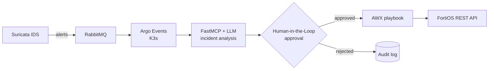

<!-- HEADER (animated wave) -->

  

<h1 align="center">Hi, I'm Brian Gerard 👋👨‍💻</h1>
<h3 align="center">Computer Engineer 🎓 | Virtualization Engineer</h3>

  

  
  
  

---

### 👨‍💻 About Me

I am a **Computer Engineer** graduated from the National University of Córdoba (UNC), working on cloud infrastructure, automation, and virtualized environments, with a strong background spanning from low-level hardware design to cloud-native architectures.

- 🚀 **Current Role:** Virtualization Engineer at **Alsus AR** (Ansible, Terraform, and Elastic Stack).
- 🎓 **Engineering Thesis:** Co-developed an automated SOC platform for network incident response using Suricata, RabbitMQ, Argo Events (K3s), FastMCP (LLMs), and AWX.
- ⚙️ **Previous Experience:** 1 year as **DevOps Engineer** at *Prosecretaría de Informática - UNC* (Kubernetes & microservices orchestration).
- 🔬 **R&D & Training:** 1 year as a **Procom Fellow (Training Grant)** at *Fundación Fulgor*, developing a complete **Real-Time Video Processing system**: DSP algorithms on FPGAs with Verilog, microcontrollers, and web interfaces.
- 📍 **Location:** Córdoba, Argentina 🇦🇷

---

### 🛣️ Journey

| Period | Milestone |
| :--- | :--- |
| **Now** | 🚀 Virtualization Engineer @ **Alsus AR** |
| **Now** | 🎓 **Computer Engineer** — Universidad Nacional de Córdoba (UNC) |
| **Previous** | ⚙️ DevOps Engineer @ Prosecretaría de Informática - UNC (1 year) |
| **Previous** | 🔬 Procom Fellow @ Fundación Fulgor (1 year) |

---

### 🛠️ Tech Stack & Tools

  

| Category | Technologies |
| :--- | :--- |
| **Virtualization & Containers** |    |
| **IaC & Automation** |     |
| **Messaging & Event-Driven** |   |
| **Observability & Security** |    |
| **Backend & Development** |   |
| **Embedded & Hardware** |    |

---

### 🎓 Engineering Thesis

Together with a colleague, we designed and implemented an end-to-end **Autonomous Operations Pipeline** to bridge the gap between passive observability and active threat remediation.

- **Event Pipeline:** Suricata IDS telemetry is ingested and routed asynchronously via RabbitMQ and Argo Events inside a K3s cluster.
- **Cognitive Decision Layer:** A FastMCP server interfaces with an LLM to evaluate complex incident context.
- **Remediation as Code:** Remediation playbooks are dynamically triggered in AWX via FortiOS REST APIs under a supervised *Human-in-the-Loop* approval model.

<b>🧭 View architecture</b>

 

---

### 📈 GitHub Activity

  
  

  

  

<!-- Snake animation: generated by .github/workflows/snake.yml (branch "output") -->

  <picture>
    <source media="(prefers-color-scheme: dark)" srcset="https://raw.githubusercontent.com/brian1062/brian1062/output/github-snake-dark.svg" />
    <source media="(prefers-color-scheme: light)" srcset="https://raw.githubusercontent.com/brian1062/brian1062/output/github-snake.svg" />
    
  </picture>

---

### 🌐 Connect with Me

  
  
  
  

<!-- FOOTER (animated wave) -->

  

